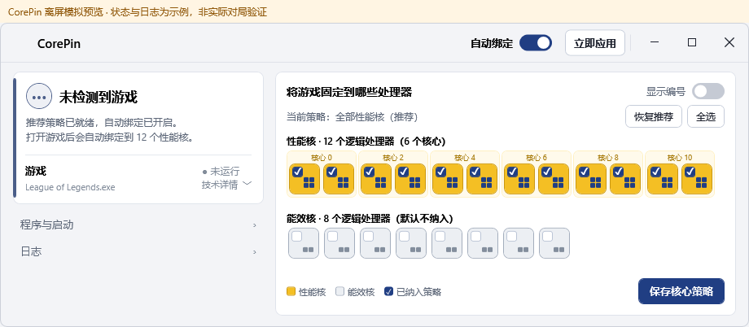
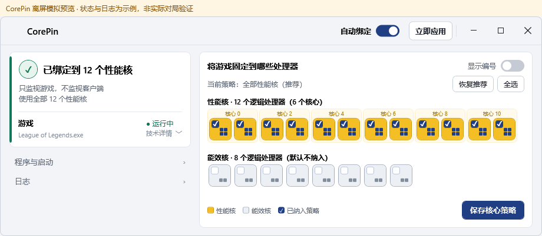

# CorePin

Windows 10/11 x64 游戏进程性能核绑定工具，使用 C# / .NET 10 LTS WPF 独立实现。通过公开 Windows API 读取实际 CPU 拓扑，为目标进程设置 CPU Sets、单处理器组亲和性，并在 Windows 11 显式关闭执行速度节流（EcoQoS）。不使用驱动或注入，不修改游戏文件，不保证提高帧率。

默认只监视 `League of Legends.exe`，界面称为“游戏”；`LeagueClient.exe`、`LeagueClientUx.exe`、`LeagueClientUxRender.exe` 默认关闭。监视规则按完整 EXE 文件名精确匹配，不区分大小写，可在“进程与启动”中增删。发现窗口只枚举进程信息，不读取游戏程序文件。

## 安装和运行

使用项目提供的 `CorePin-win-x64.zip` 时，将**整个压缩包**解压到固定的可写目录，再运行 `CorePin.exe`。自包含包附带 .NET / Windows Desktop 运行组件，不要求目标电脑另装 .NET；不要单独复制 EXE 或丢弃旁边的 DLL。此仓库提供构建及发布流程，不表示已经发布了可下载的版本。仓库地址为 [441126098/CorePin](https://github.com/441126098/CorePin)。

发布目标仅为 **Windows 10/11 x64**，不提供 ARM64 或 32 位包，也不承诺所有 Windows 10/11 版本均获微软官方支持。官方 .NET 支持取决于具体 Windows 版本、版本类别及其生命周期；Windows 10 消费版停止服务和 ESU 是另一项政策，加入 ESU 不等于进入 .NET 10 的官方支持列表。具体范围、微软来源与测试缺口见 [平台和旧版本兼容说明](docs/COMPATIBILITY.md)。

自包含包内的运行时**不会随系统安装的 .NET 自动修补**。维护者需用受支持的最新 .NET 10 补丁重新构建、验证并分发完整压缩包，用户需整体替换。自包含只免去另装 .NET 的步骤，不消除 UAC、权限限制或 SmartScreen。当前包没有代码签名。

发布包附带 `.zip.sha256` 文件，包内 `SHA256SUMS.txt` 列出每个文件的 SHA-256。可用 PowerShell 的 `Get-FileHash .\CorePin-win-x64.zip -Algorithm SHA256` 与旁边的清单比对。校验和用于核对完整性，不代表发布者身份认证。

当前 EXE **没有代码签名**，Windows SmartScreen 可能提示未知发布者或阻止启动。先核实来源和校验和；若仍有疑虑，请停止运行或自行审阅源码构建。不要关闭安全软件。未来可考虑使用代码签名证书，目前未提供签名证书或已签名版本。

1. 启动 CorePin，再照常启动游戏；只打开启动器或客户端时显示“未检测到游戏”属于正常现象。
2. 工具默认以普通用户权限启动（`asInvoker`），不自动弹出 UAC。目前界面会提供“以管理员身份重新启动”。遇到“访问被拒绝”时，请通过此按钮或 EXE 的右键菜单**重新以管理员身份启动 CorePin**，无需为解决权限错误而重启游戏。
3. 管理员权限仍可能被进程保护或反作弊拒绝。查看技术详情，停止无法完成的操作；CorePin 不绕过保护。
4. 启用自动绑定后，每轮处理完成再等待 500ms，检查设置并在被重置后重新应用。“立即应用”可在暂停自动绑定时应用一次。

## 托盘、设置和登录启动

关闭主窗口会隐藏到托盘，首次关闭会说明后台行为；可选择记住或直接退出。双击托盘图标打开主窗口，右键“退出”停止工具。托盘菜单支持开关自动绑定；托盘浮窗尚未实现。

“登录 Windows 后启动”默认关闭。请先固定解压目录，再在界面中开启；启动命令带 `--tray`，不会创建服务或计划任务，也不会自动请求管理员权限。移动程序后请关闭再开启此设置。

设置保存在 `%LOCALAPPDATA%\CorePin\settings.json`，日志只在内存保留最近 250 条。旧版设置会在新文件缺失时迁移；旧启动项只在明确操作登录启动设置时迁移。旧实例可能占用共享的单实例锁，请从托盘正常退出旧版后再启动新版。详见 [旧版本兼容说明](docs/COMPATIBILITY.md)。

## 核心策略和限制

- 核心图按本机 `GetSystemCpuSetInformation` 返回的处理器组、物理核心和逻辑处理器绘制，保留 SMT 线程；不按 CPU 型号或编号奇偶猜测 P/E 核。
- 自动推荐全机最高数值的 `EfficiencyClass`。即使有三个等级也只选最高等级。Windows 未报告性能等级差异时，明确提示并推荐全部处理器，不伪造异构划分。
- 可手动选择逻辑处理器。配置按“组号:组内逻辑编号”持久化；检测到拓扑变化时暂停绑定并要求确认。CPU Set ID 不作为跨重启的持久化标识。
- 单处理器组同时使用 CPU Sets 和 64 位亲和性掩码；多组只用 CPU Sets 表达跨组选择。CPU Sets 属于软亲和性，线程单独设置、组限制、作业对象或系统预留可能影响实际调度。读回符合策略不等于逐线程运行核心证明。
- 绑定前核对进程映像名、创建时间及 CPU 预留状态；设置后读回验证。Windows 10 不控制 EcoQoS。每轮耗时会增加检查间隔，无法保证捕获极短进程或在第一条游戏指令前完成绑定。
- 暂停、移除规则或退出只停止后续修改，已经应用的进程设置不会自动回滚；目标进程退出后设置自然消失。其他调优工具可能与 CorePin 相互覆盖。

## 许可和使用风险

代码采用 [MIT 许可证](LICENSE)，版权归 CorePin contributors。CorePin 与 Riot、腾讯或 WeGame 无隶属、授权或背书关系，保留自定义图标，不使用其商标美术素材；这不代表不存在商标风险。工具只使用有公开文档的 Windows API，无驱动、无注入，不绕过反作弊，**不承诺账号安全**。游戏和平台服务条款仍可能适用，使用者自行承担风险。请阅读 [完整使用声明](docs/DISCLAIMER.md)。随包分发的运行时组件遵循各自的许可证及第三方声明。

## 开发与验证

在 Windows x64 上使用 [.NET 10 LTS SDK](https://dotnet.microsoft.com/download/dotnet/10.0)，从仓库根目录执行。.NET 8 已于 2026-11-10 结束支持，不再用于默认发布包；见 [微软 .NET 支持政策](https://dotnet.microsoft.com/en-us/platform/support/policy/dotnet-core)。

```powershell
dotnet build .\CorePin.sln -c Release --artifacts-path .\artifacts\dev-build
dotnet .\artifacts\dev-build\bin\CorePin.Checks\release\CorePin.Checks.dll
dotnet .\artifacts\dev-build\bin\CorePin.Checks\release\CorePin.Checks.dll --native
powershell.exe -NoProfile -File .\scripts\Check-Source.ps1
powershell.exe -NoProfile -File .\scripts\Test-Text.ps1
# 启动已构建应用（会打开真实界面并加载用户设置）：
& '.\artifacts\dev-build\bin\CorePin\release\CorePin.exe'
```

普通检查覆盖拓扑解析、SMT、三性能等级、同构 CPU、跨组掩码边界、默认规则及隔离设置迁移。登录启动测试使用内存替身，不访问真实注册表。`--native` 仅修改测试进程自身，检查读回、500ms 修复循环并恢复原状态；多处理器组因无法在此测试中完整恢复原组亲和性而跳过写入测试。没有可用推荐 CPU 或无法快照 QoS 时也会明确跳过；合成拓扑测试仍会运行，不假设 CI CPU 必须为异构架构。

生成并验证完整发布包（输出目录须尚不存在）：

```powershell
powershell.exe -NoProfile -File .\scripts\Publish-Release.ps1
powershell.exe -NoProfile -File .\scripts\Test-Package.ps1 -PackagePath .\artifacts\corepin-selfcontained\CorePin-win-x64.zip -VerificationRoot .\artifacts\corepin-package-check
```

默认输出为 `artifacts\corepin-selfcontained\CorePin-win-x64.zip`。发布脚本仅打包主项目、自包含运行时、说明和许可证；构建中间文件及测试输出不进入 ZIP。不启用单文件、裁剪或 AOT 发布；[WPF 不兼容裁剪](https://learn.microsoft.com/en-us/dotnet/core/deploying/trimming/incompatibilities)。

验证脚本在独立目录解压并检查全部哈希、x64 apphost、`includedFrameworks` 及 WPF 托管/原生文件，默认拒绝依赖外部框架的包，再调用 `CorePin.exe --package-check <绝对JSON路径>`。该模式在单实例锁、设置、注册表、托盘和监视器初始化前退出，不显示窗口或请求 UAC。JSON 记录实际加载的 hostfxr、hostpolicy、coreclr、WPF 原生模块及托管程序集的包内路径；另保留 [官方主机跟踪](https://learn.microsoft.com/en-us/dotnet/core/tools/dotnet-environment-variables#dotnet_host_trace)。仅设置 `DOTNET_ROOT` 不是自包含证明。结果与跟踪文件置于解压目录旁，不能替代真实 GUI 测试。

若确需依赖外部框架，可明确使用 `Publish-Release.ps1 -FrameworkDependent -OutputRoot .\artifacts\corepin-framework-dependent` 生成 `CorePin-win-x64-framework-dependent.zip`；这类包**要求预装 .NET 10 Windows Desktop Runtime x64**。验证时必须加 `Test-Package.ps1 -AllowFrameworkDependent`，不能将其当作自包含包。已有对应 RID、配置及自包含模式的构建资产时，`-NoRestore -BuildArtifactsPath <构建目录>` 可复用离线资产；缺失资产时请停止并解决构建环境问题。默认 CI 和发布流程只接受经过验证的自包含包。

`.github/workflows/ci.yml` 在 `windows-latest` 构建并执行检查。`release.yml` 可手动只生成并上传 Actions 制品；推送 `v*` 标签或明确勾选手动发布时，才使用独立、具备 `contents: write` 权限的作业创建 GitHub Release。手动发布必须指定已经存在的标签；流程不会创建标签。审核源码、验证实机行为后再自行发布。

## 界面预览

以下图片由 `scripts/Render-Preview.ps1` 在重命名后离屏渲染。**状态、进程与日志均为模拟示例，不是实际对局或成功绑定的证明**；核心图读取渲染机器的真实拓扑。脚本不启动绑定服务，不打开窗口。





```powershell
powershell.exe -NoProfile -STA -File .\scripts\Render-Preview.ps1
```

## 公开 API 参考

- [CPU Sets](https://learn.microsoft.com/windows/win32/procthread/cpu-sets)、[处理器组](https://learn.microsoft.com/windows/win32/procthread/processor-groups)
- [GetSystemCpuSetInformation](https://learn.microsoft.com/windows/win32/api/processthreadsapi/nf-processthreadsapi-getsystemcpusetinformation)、[SYSTEM_CPU_SET_INFORMATION](https://learn.microsoft.com/windows/win32/api/winnt/ns-winnt-system_cpu_set_information)
- [SetProcessDefaultCpuSets](https://learn.microsoft.com/windows/win32/api/processthreadsapi/nf-processthreadsapi-setprocessdefaultcpusets)、[SetProcessAffinityMask](https://learn.microsoft.com/windows/win32/api/winbase/nf-winbase-setprocessaffinitymask)、[SetProcessInformation](https://learn.microsoft.com/windows/win32/api/processthreadsapi/nf-processthreadsapi-setprocessinformation)
